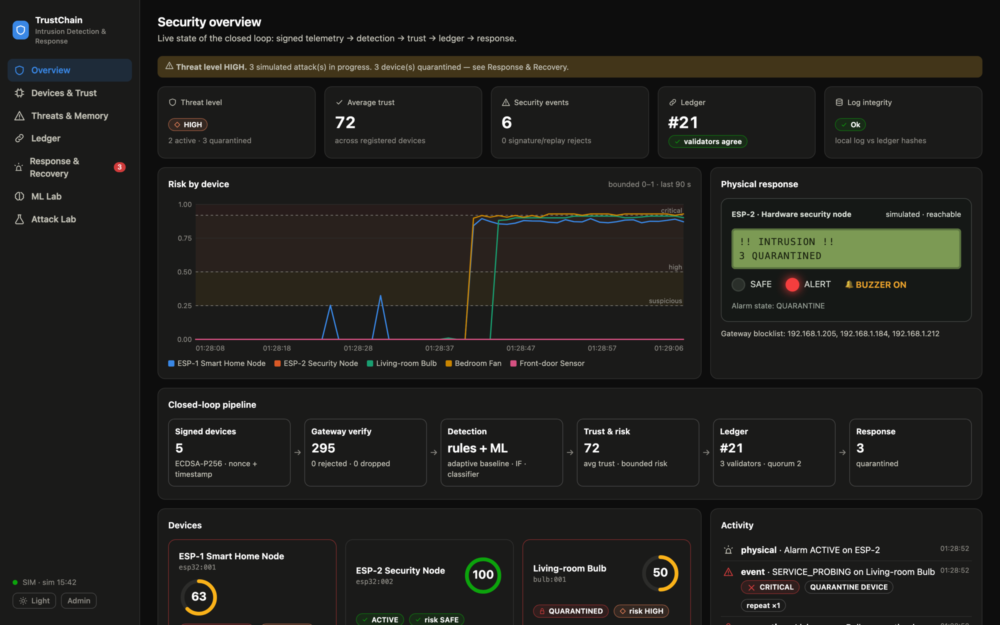
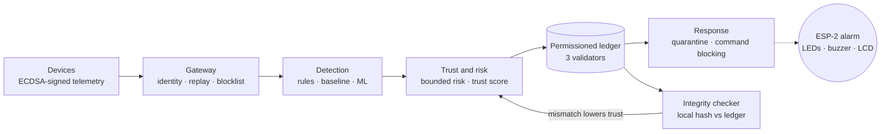
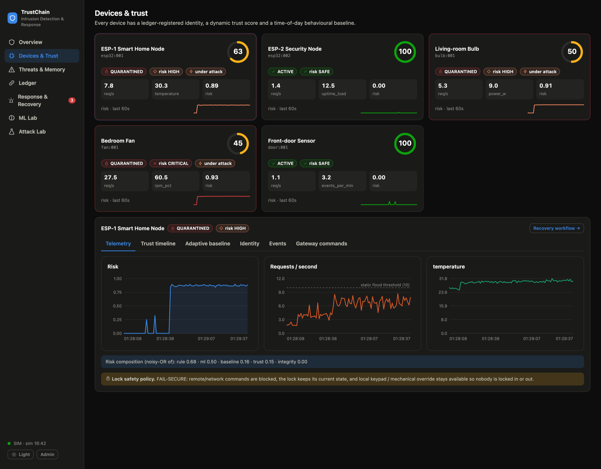
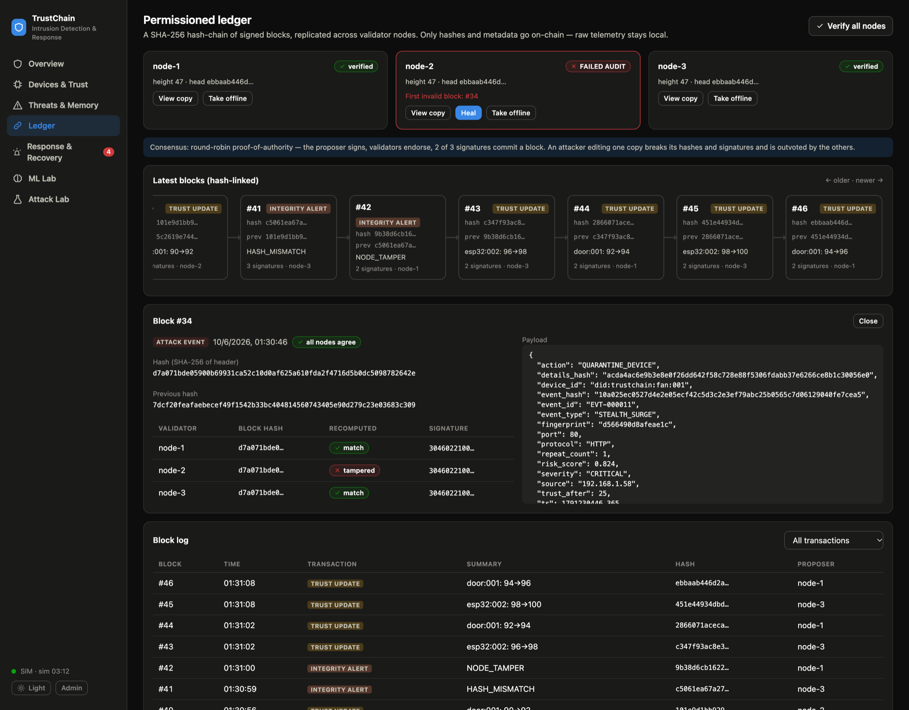
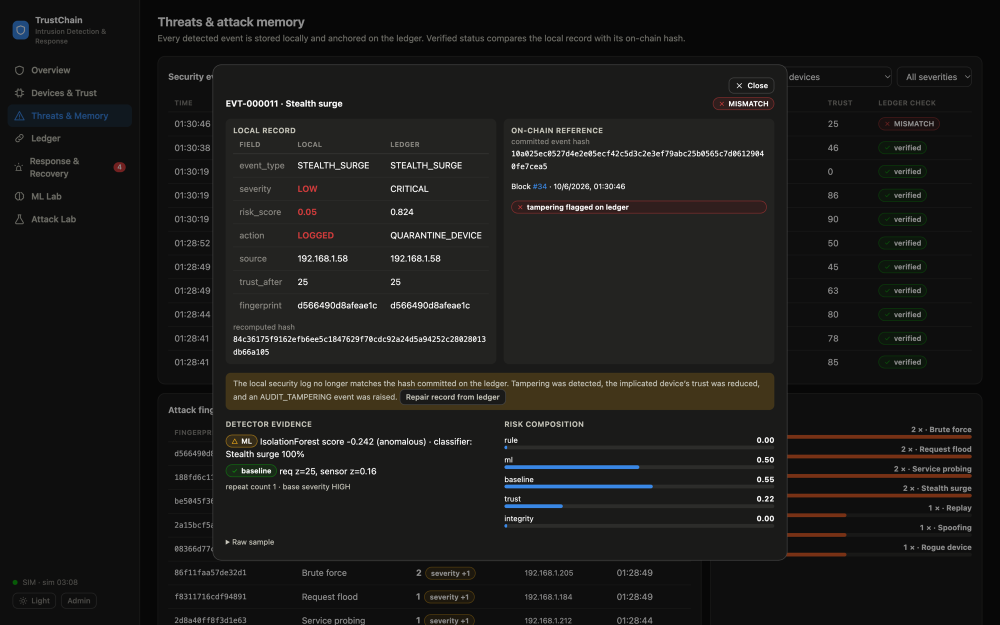
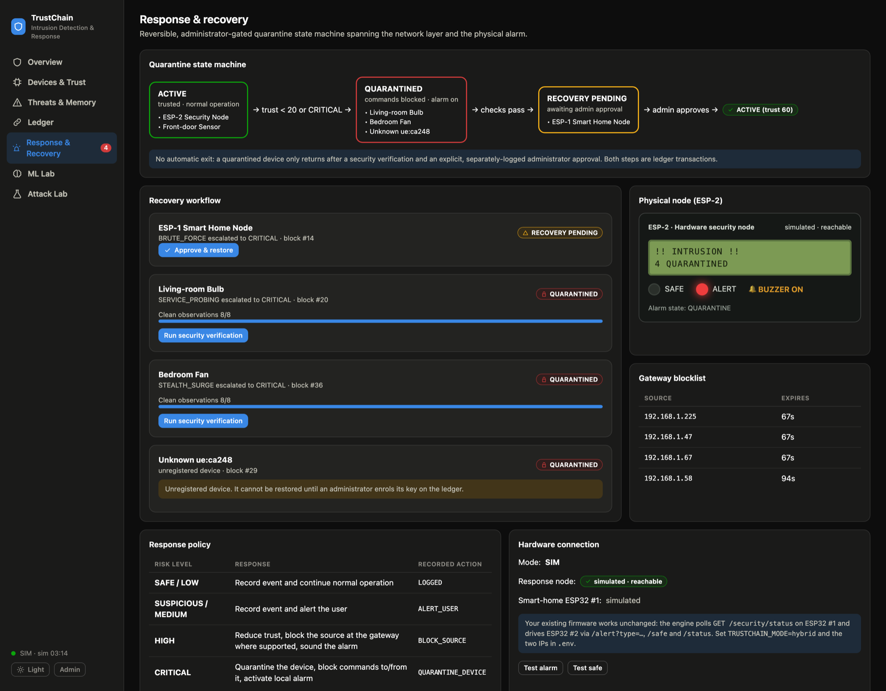
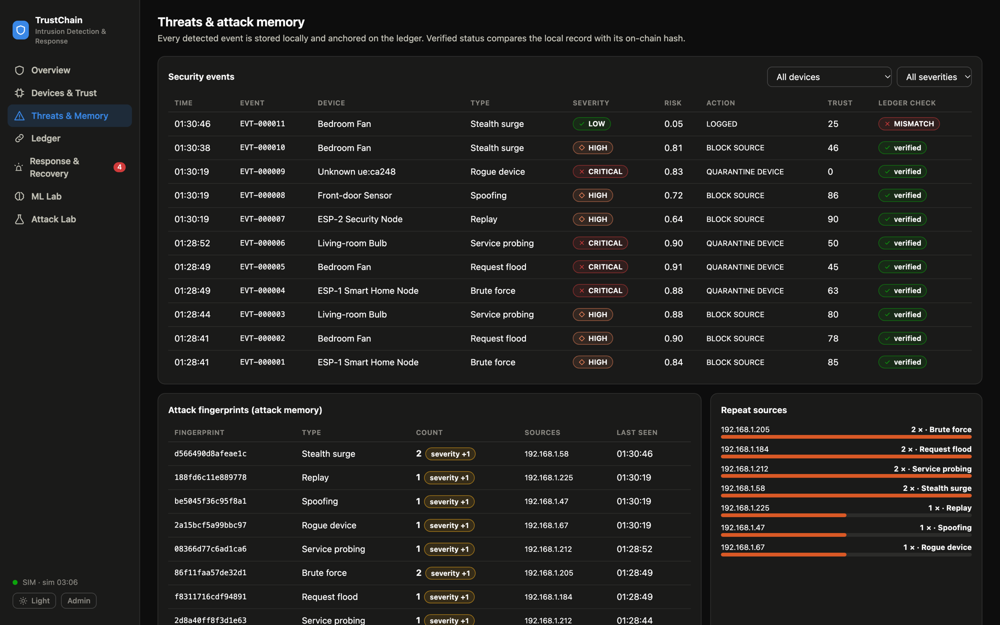
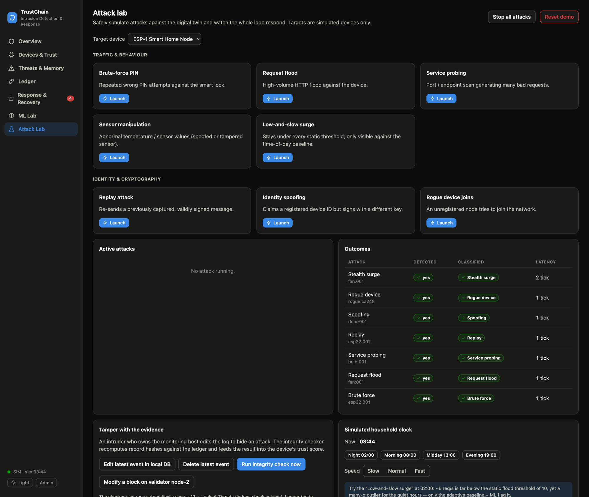

# TrustChain-IDRS

**A hardware-integrated, blockchain-backed intrusion detection and response system for smart homes.**

[](https://github.com/anshultripathi-dev/trustchain-idrs/actions/workflows/ci.yml)


TrustChain-IDRS evolves a two-ESP32 smart-home IDS into a closed-loop security system. Devices carry
cryptographic identity, detection combines rules with an adaptive baseline and machine learning,
a per-device trust score drives quarantine, and a permissioned hash-chain ledger makes the
security log **tamper-evident** — with ledger integrity feeding back into trust.

<p align="center">
  
</p>

> The screenshot shows the dashboard mid-incident (simulated): three devices quarantined, the physical
> alarm active on ESP-2, three sources on the gateway blocklist, all validators in agreement.

---

## Highlights

- **Signed telemetry.** Every message carries an ECDSA-P256 signature, a timestamp and a single-use
  nonce. The gateway rejects unknown devices, forged signatures, stale timestamps and replays.
- **Hybrid detection.** Static rules, a per-device **per-hour adaptive baseline**, an Isolation Forest
  and a Random-Forest attack classifier. On held-out simulated traffic, static thresholds alone
  reach 64 % macro recall; the hybrid reaches 100 % at a 0.03 % confirmed false-positive rate.
- **Trust and risk.** A bounded 0–1 risk value (noisy-OR of five signals) and a 0–100 trust score per
  device; attack memory escalates repeat offenders.
- **Permissioned ledger.** SHA-256 hash-chained, ECDSA-signed blocks replicated across three
  validators (round-robin proof of authority, 2-of-3 quorum). Contract state is rebuilt by
  replaying the chain.
- **Ledger → trust feedback.** Editing the local log breaks the hash committed on-chain; the
  implicated device's trust drops and it can be quarantined.
- **Reversible, fail-secure response.** `ACTIVE → QUARANTINED → RECOVERY_PENDING → ACTIVE`, with an
  explicit administrator approval that is itself a ledger transaction. A quarantined lock never
  actuates by itself.
- **Real hardware.** Works with the original ESP32 firmware unchanged (`/security/status`, `/alert`,
  `/safe`, `/status`). A full simulation mode needs no hardware at all.
- **Seven-page dashboard.** Overview, devices and trust, threats and attack memory, ledger explorer,
  response and recovery, ML lab, attack lab. Offline-capable, light and dark themes.

## How it works



Only a SHA-256 hash and compact metadata of each security event go on-chain; detailed evidence and
raw telemetry stay in a local SQLite store. Full design: [`docs/ARCHITECTURE.md`](docs/ARCHITECTURE.md).

## Quick start

Requires Python 3.10+. No hardware needed.

```bash
git clone https://github.com/anshultripathi-dev/trustchain-idrs.git
cd trustchain-idrs
make setup          # creates .venv and installs requirements
make run            # → http://127.0.0.1:8000
```

The ML models train automatically on first start (~30 s) or on demand with `make train`.
Without `make`: `python3 -m venv .venv && .venv/bin/pip install -r requirements.txt && .venv/bin/python run.py`.

Admin actions (launch simulated attacks, quarantine, approve recovery, heal a node) ask for a token;
the local-demo default is `admin` — set `TRUSTCHAIN_ADMIN_TOKEN` for anything else. The server binds to
`127.0.0.1` by default.

### With the real ESP32 boards

1. Flash [`firmware/esp1`](firmware/esp1) and [`firmware/esp2`](firmware/esp2) (set your Wi-Fi in the sketch).
2. Copy `.env.example` to `.env` and set:

   ```
   TRUSTCHAIN_MODE=hybrid
   ESP32_SMART_HOME_IP=<ESP32 #1 IP>
   ESP32_SECURITY_IP=<ESP32 #2 IP>
   ```
3. `make run`. The Response & Recovery page shows the hardware connection state.

In hybrid mode ESP-1 and ESP-2 are real; the bulb, fan and door sensor stay simulated. Wiring, pin maps
and details: [`docs/HARDWARE.md`](docs/HARDWARE.md).

## Screenshots

| | |
|---|---|
| <br/>**Devices and trust** — telemetry, risk, ledger-derived trust | <br/>**Ledger explorer** — a tampered validator fails audit |
| <br/>**Tamper evidence** — local record vs on-chain hash | <br/>**Response and recovery** — state machine, alarm, blocklist |
| <br/>**Threats and attack memory** | <br/>**Attack lab** — eight scenarios, tamper controls |

More in [`docs/images/`](docs/images), including the ML lab panels and the real boards.

## Results

All figures come from the built-in simulator (**synthetic data**, not a real household) and are
reproducible with `make evaluate`. Details and caveats: [`docs/EVALUATION.md`](docs/EVALUATION.md).

| Detector (held-out simulated episodes) | Macro recall | False positives (2-tick confirm) |
|---|---|---|
| Static rules (original IDS) | 64.0 % | 0.01 % |
| Isolation Forest only | 91.3 % | 0.02 % |
| **Hybrid: rules + IF + classifier** | **100 %** | **0.03 %** |

End-to-end (3 trials per scenario, fresh systems, virtual clock): all 8 attack scenarios and both
tamper scenarios detected in every trial, mean detection latency 1–2 ticks, and 1 false event in 6,000
clean device-ticks (≈ 4 simulated days) with no false quarantines.

## Repository layout

```
trustchain/
  crypto.py            ECDSA, canonical JSON, SHA-256
  identity.py          signed envelopes, nonce cache, gateway verification
  ledger/chain.py      hash-chain, validators, consensus, audit, heal
  ledger/contract.py   smart-contract state machine (replayed from the chain)
  detection/           rules, adaptive baseline, features, Isolation Forest + classifier, training
  trust.py             bounded risk, severity bands, trust penalties
  fingerprint.py       attack fingerprints
  store.py             local SQLite event store (hash-covered)
  integrity.py         ledger-integrity checker (feeds trust)
  response.py          command policy, blocklist, lock fail-secure rules
  hardware.py          ESP32 adapters (legacy telemetry poller, response node, simulated node)
  engine.py            the closed loop, quarantine state machine, attack simulation
  evaluation.py        headless scenario evaluation
  api.py               FastAPI REST + WebSocket
web/                   dashboard (no-build ES modules, SVG charts)
firmware/              ESP32 sketches (esp1 smart-home node, esp2 security node)
tests/                 32 tests: ledger, engine, API, hardware adapters
scripts/               train_models.py, evaluate.py
docs/                  architecture, hardware, demo, evaluation, threat model, images, proposals
```

## Documentation

| Document | Contents |
|---|---|
| [`docs/ARCHITECTURE.md`](docs/ARCHITECTURE.md) | Layers, message format, ledger, detection, trust, state machine, diagrams |
| [`docs/HARDWARE.md`](docs/HARDWARE.md) | Bill of materials, wiring, endpoints, flashing, hybrid mode |
| [`docs/DEMO.md`](docs/DEMO.md) | A three-minute guided demonstration, simulated and on real hardware |
| [`docs/EVALUATION.md`](docs/EVALUATION.md) | Method, results, how to reproduce, limits of the evidence |
| [`docs/THREAT_MODEL.md`](docs/THREAT_MODEL.md) | Assets, adversaries, mitigations, residual risks |
| [`docs/proposals/`](docs/proposals) | The original project proposal and the blockchain architecture note |

## Development

```bash
make test           # 32 tests, hermetic (forces simulation mode regardless of .env)
make evaluate       # full attack-scenario evaluation (~5 min), writes data/evaluation.json
make check-js       # syntax-check the dashboard modules
```

CI runs the tests and the JS syntax check on every push. See [`CONTRIBUTING.md`](CONTRIBUTING.md).

## Known limitations

This is a research prototype. In short: ML results are on synthetic data; the three validators run on
one machine (tamper-evidence, not Byzantine fault tolerance); keys are PEM files rather than secure
elements; the stock ESP-1 firmware cannot sign, so the gateway attests for it; on real hardware the
ML layer runs in *shadow mode* (rules act) until retrained on real telemetry. The full list is in
[`docs/THREAT_MODEL.md`](docs/THREAT_MODEL.md).

## Roadmap

1. On-device ECDSA signing in the ESP32 firmware, with flash encryption and secure boot.
2. Collect real telemetry, retrain, and enable ML on hardware.
3. Validators on separate machines; evaluate Hyperledger Fabric.
4. Dedicated gateway node (ESP32-S3 or router).
5. Push / e-mail notifications and role-based access.

## Provenance and licence

Built from the proposals in [`docs/proposals/`](docs/proposals). The original Smart Home Cybersecurity IDS
(two ESP32 boards, Flask, Isolation Forest) is the starting point; its diagram is kept in
[`docs/images/original-architecture.jpeg`](docs/images/original-architecture.jpeg).

The proposal marks its novelty claims as preliminary and recommends consulting the institution's IP
office before any public disclosure — hence this repository is **private**. No licence has been chosen
yet; until one is added, all rights are reserved.
