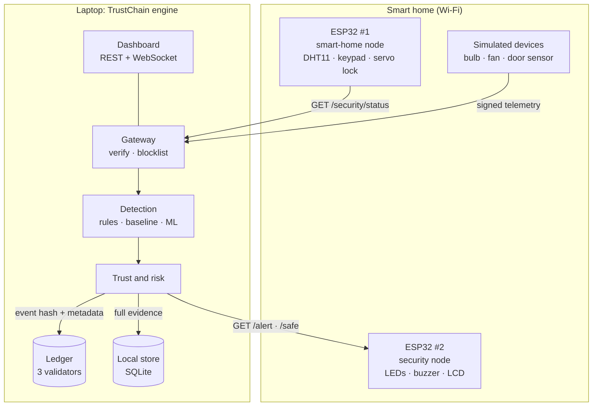
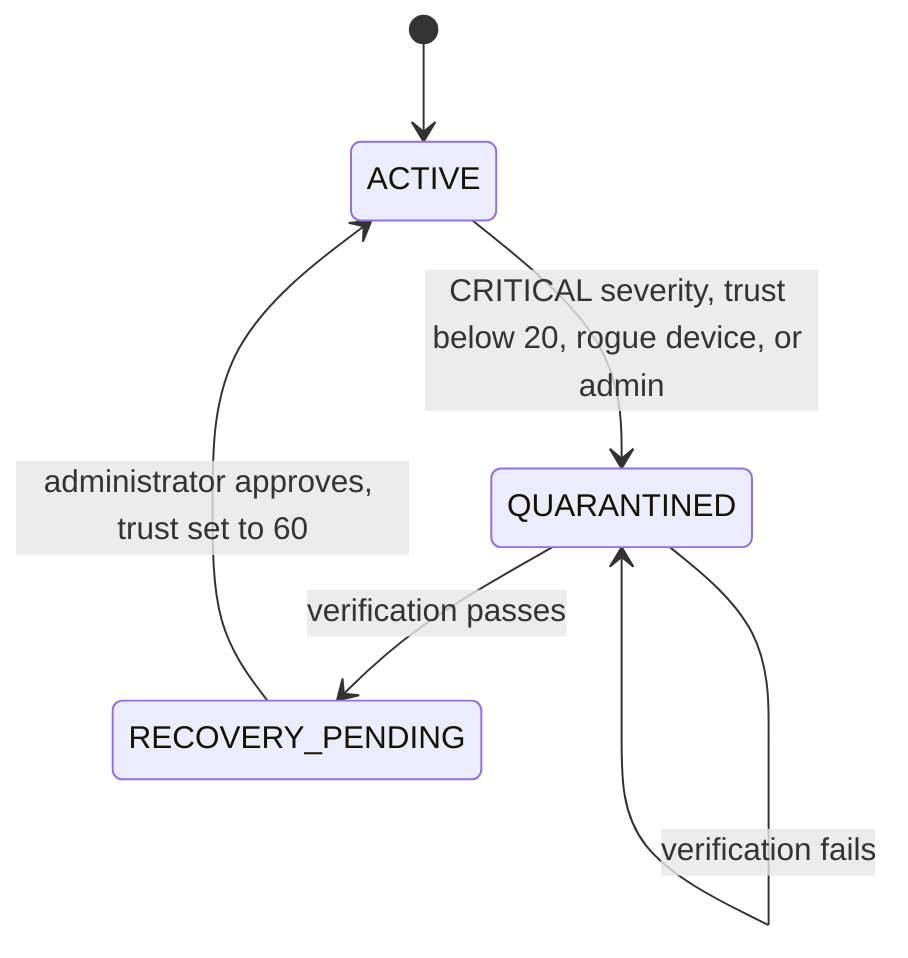
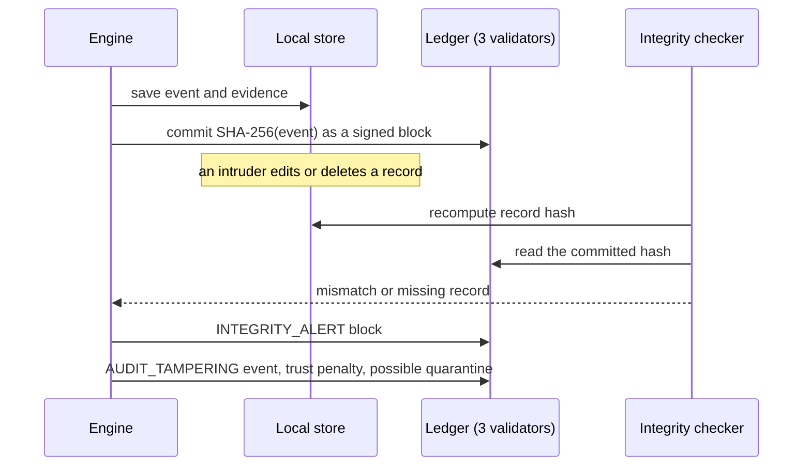
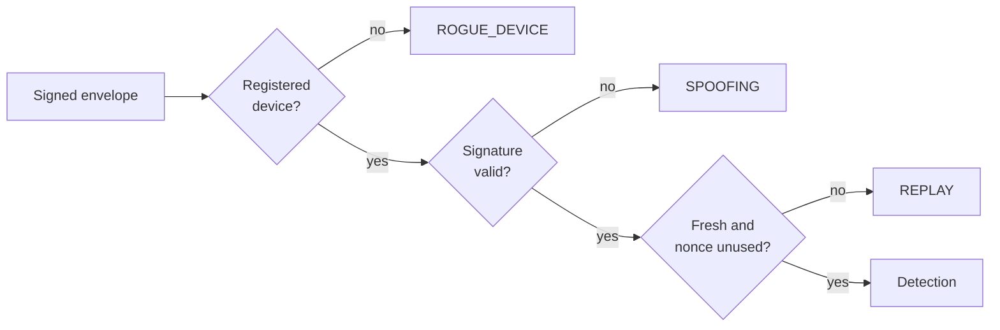

# Architecture

## Diagrams

### System context



### Quarantine state machine



### Tamper detection and the trust feedback



### Message path through the gateway



The original system (two ESP32 boards, Flask, Isolation Forest) is kept for reference in
[`images/original-architecture.jpeg`](images/original-architecture.jpeg).

## 1. Layers

| Layer | Responsibility | Where |
|---|---|---|
| Devices | ESP-1 smart-home node (DHT, keypad, servo lock), ESP-2 security node (LEDs, buzzer, LCD), bulb, fan, door sensor. Each holds an ECDSA-P256 key. | `sim/profiles.py`, `firmware/` |
| Gateway | Verifies identity, signature, timestamp window (30 s) and single-use nonce; applies the blocklist. | `identity.py`, `engine._ingest` |
| Detection | Static rules → adaptive per-device/per-hour baseline → Isolation Forest + Random-Forest classifier → confirmation. | `detection/` |
| Trust & risk | Per-device trust 0–100; bounded risk 0–1 (noisy-OR of five signals); bands. | `trust.py` |
| Ledger | Permissioned hash-chain, one tx per block, replicated to 3 validators; smart-contract state machine replayed from the chain. | `ledger/` |
| Response | Quarantine state machine, command enforcement, physical alarm. | `engine.py`, `response.py`, `hardware.py` |
| Integrity | Recompute local record hashes, compare to chain, audit validators; result feeds trust. | `integrity.py` |

Only SHA-256 hashes and metadata go on-chain; detailed records and raw telemetry stay in `data/local.db`.

## 2. Message format

```jsonc
{ "device_id": "did:trustchain:esp32:001",
  "payload": "{\"device_id\":\"…\",\"timestamp\":1789140000.0,\"nonce\":\"8fa32d…\",\"req_rate\":2.4,…}",
  "signature": "<hex DER ECDSA-P256 over the exact payload string>" }
```
The device signs the payload *string*, so firmware does not need to reproduce JSON canonicalisation.
Rejections: `UNKNOWN_DEVICE → ROGUE_DEVICE`, `BAD_SIGNATURE → SPOOFING`, `REPLAY / STALE_TIMESTAMP → REPLAY`.

## 3. Ledger

Block = `{index, timestamp, tx_type, payload, prev_hash, proposer, hash, signatures}`;
`hash = SHA-256(canonical(header))`. The proposer (round-robin among healthy validators) signs the
hash, the others validate and endorse; a block commits with ≥ ⌊n/2⌋+1 signatures. Genesis carries the
validator public keys and the contract policy.

Tamper detection layers: (1) hash recomputation, (2) `prev_hash` linkage, (3) proposer + quorum
signatures against genesis keys — an attacker who rewrites and **re-hashes** the whole chain still
fails here without validator keys, (4) cross-node comparison (a forked but self-consistent copy
disagrees with the majority). A flagged node is excluded from consensus until healed from the majority.

Transactions: `REGISTER_DEVICE`, `ATTACK_EVENT`, `TRUST_UPDATE`, `QUARANTINE`, `RECOVERY_VERIFIED`,
`RESTORE`, `INTEGRITY_ALERT`.

### Smart-contract functions (`ledger/contract.py`)

`registerDevice`, `verifyDevice`, `recordAttack`, `updateTrustScore` (returns `quarantine_required`
when trust < 20), `quarantineDevice`, `verifyAttackRecord`, `restoreDevice` (requires a completed
recovery verification), plus `assess_recurrence` (attack memory) and `recordRecoveryVerified`.
State is not stored separately: it is rebuilt by replaying the chain on start-up (tested).

## 4. Event hash

`event_hash = SHA-256(canonical({event_id, ts, device_id, event_type, severity, risk_score, source,
fingerprint, trust_after, action, details_hash}))` where `details_hash` covers the full evidence
(detector outputs, features, raw sample). Editing *any* of them locally is detectable.

## 5. Detection

* **Rules** (original thresholds): flood ≥ 10 req/s, probing (bad-request ≥ 5/s or ≥ 8 endpoints),
  brute force ≥ 3 failed PINs, temperature outside 0–40 °C, humidity > 90 %.
* **Adaptive baseline**: per device, per hour, Welford mean/σ (interpolated between hours,
  forgetting after 600 samples). Only clean observations update it.
* **Features**: `req_rate, bad_req_rate, failed_auth, endpoints_hit, |sensor z|, req z`.
* **Models**: Isolation Forest on normal traffic (threshold = 0.5th percentile of validation
  scores) + Random Forest attack-class classifier (confidence ≥ 0.7). ML-only evidence must persist
  for 2 consecutive ticks (the original IDS’s confirmation idea).
* **Fingerprint**: `SHA-256(type, device, source, port, protocol, rate bucket, failed bucket)[:16]`.
  Timestamps are excluded so repeats match.

## 6. Trust, risk and response

`risk = 1 − Π(1 − wᵢ·sᵢ)` over rule severity (0.80), ML (0.50), baseline deviation (0.55),
low trust (0.40), open ledger-integrity alert (0.90). Bands: < 0.25 SAFE, < 0.50 SUSPICIOUS,
< 0.92 HIGH, else CRITICAL.

Severity = band, **escalated by attack memory** (≥ 1 related prior event in 60 min → +1, ≥ 3 → +2).
Trust penalty = base(event type) × (1 + 0.5·min(repeats, 3)) × severity weight.

| Severity | Recorded action |
|---|---|
| LOW | log only |
| MEDIUM | alert the user |
| HIGH | block source at gateway, reduce trust, alarm |
| CRITICAL, or trust < 20 | quarantine + alarm |

Trust regenerates slowly (+2 per 6 clean ticks after a 20-tick cool-down) and never exits quarantine.
All base penalties and thresholds are *policy values to calibrate*, not security constants.

## 7. Quarantine state machine

```
ACTIVE ──(CRITICAL | trust<20 | admin)──► QUARANTINED ──(verification passes)──► RECOVERY_PENDING ──(admin approves)──► ACTIVE (trust 60)
```
Verification: key is enrolled, ≥ 8 consecutive clean observations, no attack in progress, ledger
consistent. Each transition is a ledger transaction; the physical alarm stays on until the last
quarantined device is released.

## 8. Safety decisions

* **Lock = fail-secure.** Quarantine blocks remote commands to/from the lock; it never actuates the
  lock by itself; local keypad / mechanical override are unaffected.
* **Victims are not punished for forged traffic.** Replay/spoof events are capped at HIGH, reduce
  victim trust by 40 % of the normal penalty, and block the *source* instead.
* **Unregistered devices** are quarantined immediately and cannot be restored until enrolled.
* **Dashboard-originated commands and every recovery approval need the admin token** and are logged.

## 9. Mapping to the architecture document

| Document section | Implementation |
|---|---|
| §3 ledger of events (hash + metadata) | `ATTACK_EVENT` blocks, hash of local record |
| §4 tamper detection | `IntegrityChecker`, Threats page “Ledger check” |
| §5 device identity | `REGISTER_DEVICE`, `verifyDevice`, rogue-device flow |
| §6 trust score | `TRUST_UPDATE` blocks, Devices → Trust timeline |
| §7 attack memory, §8 fingerprint | `fingerprint.py`, `assess_recurrence`, Threats page |
| §9 response, §10 quarantine, §11 recovery | `Engine._raise_event`, state machine, Response page |
| §12 smart-contract functions | `SecurityContract` |

## 10. Real-hardware behaviour

Lessons from running against the physical boards, now part of the design:

* **ML shadow mode.** Models trained on simulator traffic misread an idle real ESP-1 (≈ 0 req/s) as anomalous.
  On real hardware only rules raise events; ML scores are recorded as evidence. `TRUSTCHAIN_REAL_ML=1` enables ML there.
* **Rolling failed-PIN window.** The firmware exposes a cumulative counter; the poller keeps a 30-second window
  so human-speed keypad attempts reach the brute-force threshold.
* **Network I/O is off the engine lock.** ESP-1 is polled and ESP-2 `/status` refreshed by background threads.
* **Self-resync of ESP-2.** If the board disagrees with the system state (unreachable at command time, or left in
  alarm by an earlier run), the engine re-sends the right command.
