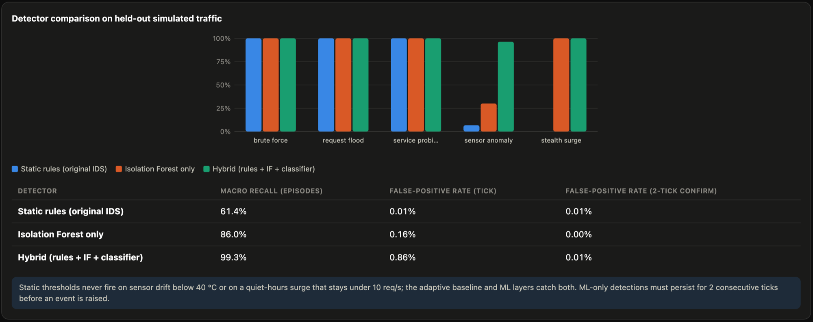
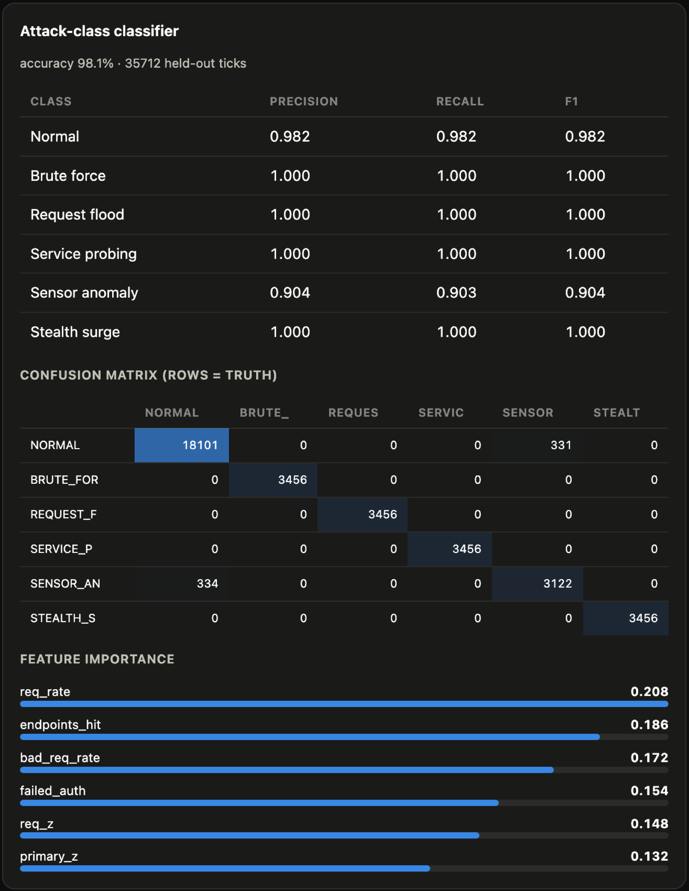
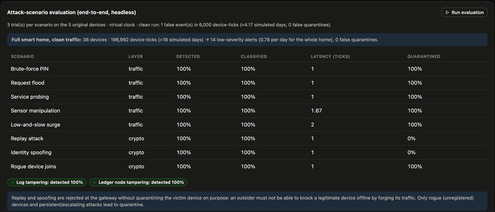

# Evaluation

> **Scope.** Every number here comes from the built-in traffic simulator (`trustchain/sim/profiles.py`),
> which generates the training data *and* the test data (with separate random streams). The results show how the
> detection methods compare **under the same assumptions**; they are not accuracy claims for a real household.
> Re-measure on real telemetry before drawing real-world conclusions.

Raw results: [`results/ml-metrics.json`](results/ml-metrics.json) (model comparison) and
[`results/evaluation.json`](results/evaluation.json) (end-to-end scenarios). Regenerate this page with
`python scripts/gen_eval_doc.py`.

## 1. Detector comparison (held-out simulated episodes)

Trained on **16 device archetypes** (appliance, bulb, camera, climate, door_sensor, energy, fan, fridge, media, motor, network, oven, personal, safety_sensor, security_node, smart_home_node), which the 38 devices of the full smart home map onto.
Data: 22,119 train / 18,432 test normal ticks; 11,520 train / 17,280 test attack ticks
across five traffic-attack classes. An *episode* counts as detected if the detector fires within it (ML-only evidence must persist
for two consecutive ticks; rules fire immediately).

| Detector | Macro episode recall | False positives (per tick) | False positives (2-tick confirm) |
|---|---|---|---|
| Static rules (original IDS) | 61.4 % | 0.01 % | 0.005 % |
| Isolation Forest only | 86.0 % | 0.16 % | 0.000 % |
| Hybrid (rules + IF + classifier) | 99.3 % | 0.86 % | 0.011 % |

Episode recall by attack class:

| Attack | Static rules | Isolation Forest only | Hybrid |
|---|---|---|---|
| Brute Force | 100.0 % | 100.0 % | 100.0 % |
| Request Flood | 100.0 % | 100.0 % | 100.0 % |
| Service Probing | 100.0 % | 100.0 % | 100.0 % |
| Sensor Anomaly | 6.8 % | 30.2 % | 96.4 % |
| Stealth Surge | 0.0 % | 100.0 % | 100.0 % |

Static thresholds cannot see sensor drift that stays inside the legal range or a quiet-hours surge that stays under 10 req/s.
The adaptive baseline and ML layers catch both. The Isolation Forest alone is weak on sensor tampering across such different
devices (a fridge, an oven and a router have very different "normal"), which is where the attack classifier and per-device baseline
add the most.



## 2. Attack-class classifier

Random Forest (200 trees, balanced classes), accuracy **98.1 %** on the held-out ticks.

| Class | Precision | Recall | F1 |
|---|---|---|---|
| Normal | 0.982 | 0.982 | 0.982 |
| Brute Force | 1.000 | 1.000 | 1.000 |
| Request Flood | 1.000 | 1.000 | 1.000 |
| Service Probing | 1.000 | 1.000 | 1.000 |
| Sensor Anomaly | 0.904 | 0.903 | 0.904 |
| Stealth Surge | 1.000 | 1.000 | 1.000 |

Sensor anomalies are the hardest class: across 16 archetypes some normal readings look like a tampered sensor and vice versa.
That is exactly why classifier output alone never quarantines a device (see §4).



## 3. End-to-end scenarios

3 trials per scenario, each on a fresh in-memory system (the five original devices) with a virtual clock (1 tick = 1 s).
*Latency* is ticks from attack start to the first security event.

| Scenario | Layer | Detected | Classified correctly | Mean latency (ticks) | Quarantined |
|---|---|---|---|---|---|
| Brute-force PIN | traffic | 100 % | 100 % | 1.0 | 100 % |
| Request flood | traffic | 100 % | 100 % | 1.0 | 100 % |
| Service probing | traffic | 100 % | 100 % | 1.0 | 100 % |
| Sensor manipulation | traffic | 100 % | 100 % | 1.67 | 100 % |
| Low-and-slow surge | traffic | 100 % | 100 % | 2.0 | 100 % |
| Replay attack | crypto | 100 % | 100 % | 1.0 | 0 % |
| Identity spoofing | crypto | 100 % | 100 % | 1.0 | 0 % |
| Rogue device joins | crypto | 100 % | 100 % | 1.0 | 100 % |

Replay and spoofing intentionally do **not** quarantine the victim: the gateway blocks the source and only mildly reduces the
victim's trust, so an outsider cannot knock a legitimate device offline by forging its traffic.

| Tamper scenario | Detected | Device quarantined |
|---|---|---|
| Local log edited | 100 % | 100 % |
| Validator copy modified | 100 % | 0 % (network keeps running on the quorum) |

**Clean traffic (five devices):** 1 false event(s) in 6,000 device-ticks (≈ 4.17 simulated days), 0 false quarantines.



## 4. The full smart home on clean traffic

All 38 devices across every room, 196,992 device-ticks (≈ 18.0 simulated days, three random seeds), no attacks:

| Measure | Result |
|---|---|
| Security events raised | 14 (0.78 per simulated day for the whole home) |
| By severity | Low 2, Medium 11, High 1 |
| **False quarantines** | **0** |

Weak, unexplained evidence (no rule hit and low overall risk) may only *alert*: it can never escalate to blocking or quarantine by
repeating. Only rule hits or strong multi-signal risk can. Before this cap was introduced, the same soak produced false
quarantines of a door lock and a router from repeated borderline ML anomalies.

Per-tick processing time is measured separately (`ms_per_tick` in the JSON depends on what else the machine was doing); a standalone
38-device tick takes on the order of 15–20 ms because ML inference is batched across all devices in a tick.

## 5. Reproduce

```bash
make train       # retrains the models and rewrites models/metrics.json
make evaluate    # runs everything above (≈ 5–15 minutes depending on the machine)
cp data/evaluation.json docs/results/evaluation.json && cp models/metrics.json docs/results/ml-metrics.json
python scripts/gen_eval_doc.py
```

Results vary slightly with the random seeds; the qualitative picture (static < IF < hybrid, all scenarios detected, no false
quarantines) is stable.

## 6. What this evidence does not show

- Real-world accuracy, real attacker behaviour, or long-term baseline drift.
- Behaviour on devices whose traffic differs from the 16 simulated archetypes.
- Adversarial robustness of the ML layer (an adaptive attacker who learns the thresholds).
- On real hardware the ML layer runs in **shadow mode**: models trained on simulator data flagged an idle ESP-1 as anomalous,
  so there rules act and ML only observes until it is retrained on real telemetry.
