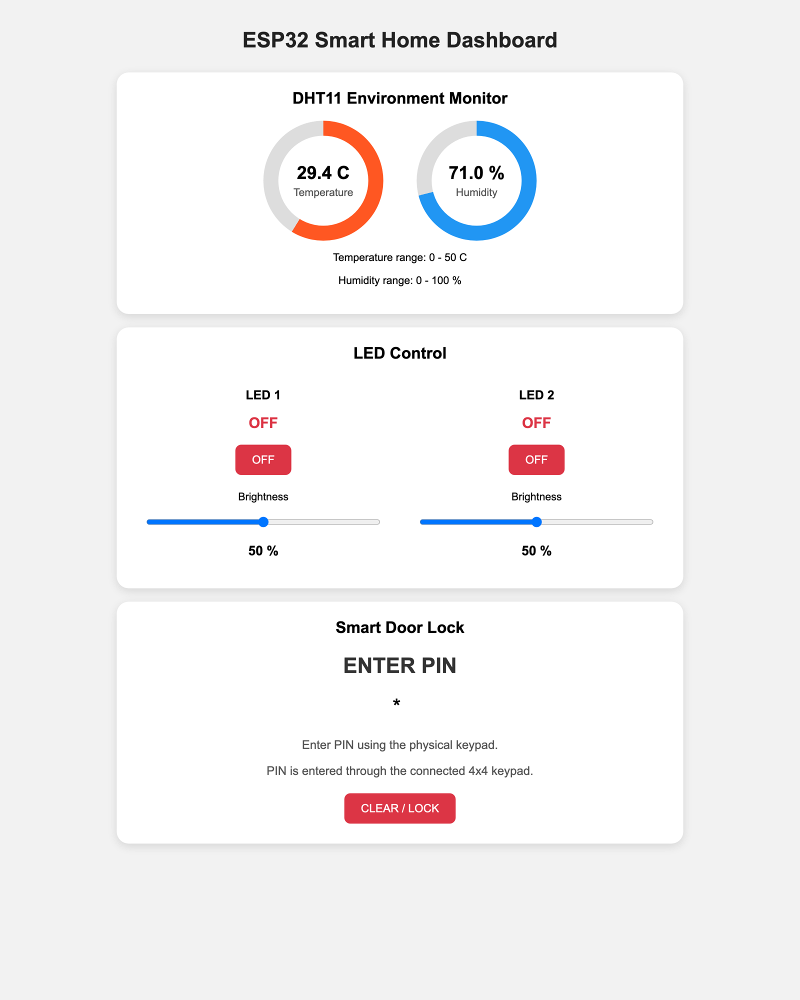

# Hardware guide

TrustChain-IDRS uses two ESP32 boards and a laptop on one Wi-Fi network. The firmware is the original
two-board IDS firmware — **unchanged**; TrustChain only reads from and commands it over plain HTTP.




## Bill of materials

| Item | Role | Qty |
|---|---|---|
| ESP32 DevKit (WROOM-32) | ESP32 #1, smart-home node | 1 |
| ESP32 DevKit (WROOM-32) | ESP32 #2, security / response node | 1 |
| DHT11 | Temperature and humidity | 1 |
| 4×4 matrix keypad | Local PIN entry | 1 |
| SG90 micro servo | Door-lock actuator | 1 |
| LEDs (2) + resistors | Controllable lights on ESP32 #1 | 2 |
| Red LED, green LED + resistors | Alarm / safe indicators on ESP32 #2 | 1 set |
| Active buzzer | Audible alarm | 1 |
| 16×2 I²C LCD (address `0x27`) | Status text on ESP32 #2 | 1 |
| Breadboards, jumper wires, USB cables | Prototyping | as needed |
| Laptop running Python 3.10+ | Engine, ledger, dashboard | 1 |

The proposal suggests an ESP32-S3 as a dedicated gateway; in this implementation the gateway role runs in
software on the laptop.

## Pin map

### ESP32 #1 — smart-home node (`firmware/esp1/esp1.ino`)

| Function | GPIO |
|---|---|
| DHT11 data | 4 |
| LED 1 / LED 2 (PWM) | 25 / 26 |
| SG90 servo signal | 18 |
| Keypad rows | 13, 14, 27, 32 |
| Keypad columns | 19, 21, 22, 23 |

### ESP32 #2 — security node (`firmware/esp2/esp2.ino`)

| Function | GPIO |
|---|---|
| Green LED (safe) | 25 |
| Red LED (alert) | 26 |
| Buzzer | 27 |
| LCD SDA / SCL (I²C, `0x27`, 16×2) | 21 / 22 |

## Flashing

1. Install the Arduino IDE (or `arduino-cli`) with the **esp32** board package.
2. Libraries: `ESP32Servo`, `Keypad`, `DHT sensor library` (+ Adafruit Unified Sensor), `LiquidCrystal_I2C`.
   `WiFi` and `WebServer` ship with the ESP32 core.
3. In each sketch set your network:

   ```cpp
   const char* ssid = "YOUR_WIFI_SSID";
   const char* password = "YOUR_WIFI_PASSWORD";
   ```

   Never commit real credentials. `firmware/.local/` is git-ignored if you want to keep a private copy.
4. Select *ESP32 Dev Module*, flash each board, and read its IP address from the Serial Monitor (115200 baud).
5. The demo PIN in the original project is `1111`. Change it in the sketch for anything beyond a lab bench.

## HTTP contract

| Endpoint | Board | Purpose |
|---|---|---|
| `GET /security/status` | ESP32 #1 | JSON: `temperature`, `humidity`, `lock_state`, `failed_pin_attempts`, `total_requests`, `wifi_rssi`, `uptime_ms`, LED state |
| `GET /alert?type=<NAME>` | ESP32 #2 | Red LED + buzzer on, LCD shows the alert type |
| `GET /safe` | ESP32 #2 | Green LED on, buzzer off, LCD shows SAFE |
| `GET /status` | ESP32 #2 | JSON: alarm state, LED / buzzer levels, request count |

## Connecting TrustChain

```bash
cp .env.example .env
```

```
TRUSTCHAIN_MODE=hybrid
ESP32_SMART_HOME_IP=<ESP32 #1 IP>
ESP32_SECURITY_IP=<ESP32 #2 IP>
```

Check the boards from the laptop first (same Wi-Fi network):

```bash
curl http://<ESP32 #1 IP>/security/status
curl http://<ESP32 #2 IP>/status
```

Then `make run` and open **Response & Recovery** → *Hardware connection*.

### What changes in hybrid mode

- **ESP-1 is real.** Temperature, humidity, failed PINs and request counters come from the board. The
  simulated-attack buttons refuse to target it — generate real traffic instead.
- **ESP-2 is real.** The red LED, buzzer and LCD fire on quarantine and clear after an administrator releases the
  last quarantined device. If the board is unreachable when a command is sent, the engine re-sends it when the
  board is back (self-resync every few seconds).
- **The rest of the smart home stays simulated**: the other 36 devices across all rooms (see [`SMART_HOME.md`](SMART_HOME.md)).
  The two boards appear in the home as the *Entrance* door lock and the *Hallway* security node.
- **The clock switches to real time.** ESP-1's behavioural baseline starts empty, so rules do the detecting at first.
- **ML runs in shadow mode on real hardware.** The models were trained on simulator traffic and misread an
  idle real device as anomalous, so only rules raise events there. Set `TRUSTCHAIN_REAL_ML=1` to let ML act,
  ideally after retraining on real telemetry.
- **Failed PINs are counted over a rolling 30-second window**, because a person at a keypad needs several
  seconds per attempt. Three wrong PINs within 30 s trigger the brute-force rule.
- **Unsigned firmware.** The stock ESP-1 firmware cannot sign messages, so the gateway attests on its behalf
  (marked `gateway_attested` in the event evidence). Native signing is on the roadmap.

### Safety

A quarantined smart lock is **fail-secure**: remote commands are blocked and the lock keeps its current state;
the keypad and any mechanical override keep working. TrustChain never actuates the lock on its own.

## Troubleshooting

| Symptom | Likely cause |
|---|---|
| Dashboard shows ESP-1 *offline* | Laptop and board not on the same network, or the board's IP changed (check Serial Monitor, update `.env`, restart) |
| ESP-2 stays in alarm after a stop | Send `GET /safe` to the board; the engine does this itself while running |
| Immediate quarantine of ESP-1 on page load | Use current code: ML is in shadow mode on real hardware; check `TRUSTCHAIN_REAL_ML` is unset |
| Brute force never triggers | Need ≥ 3 wrong PINs within 30 s; check *Devices → ESP-1* for the failed-PIN counter |
