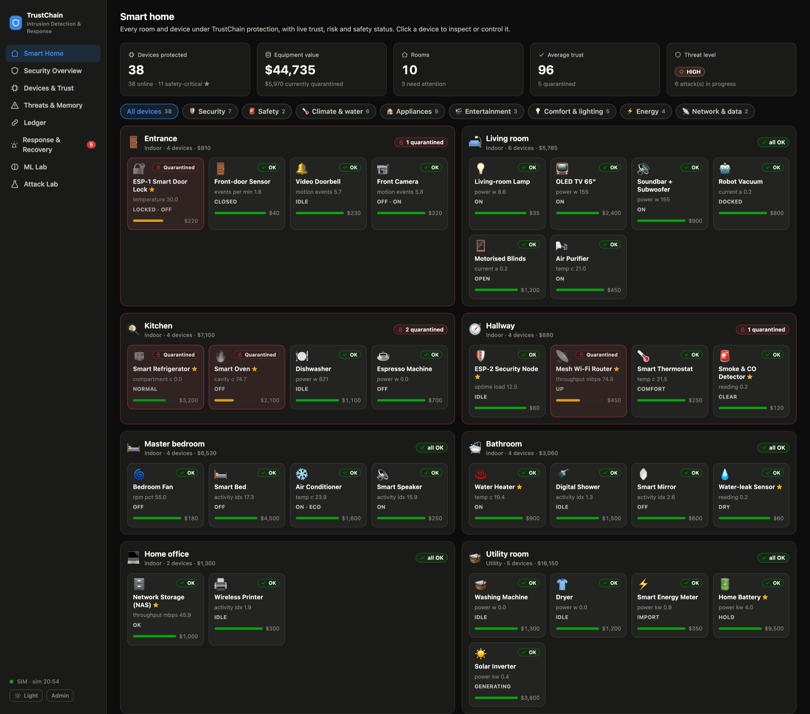
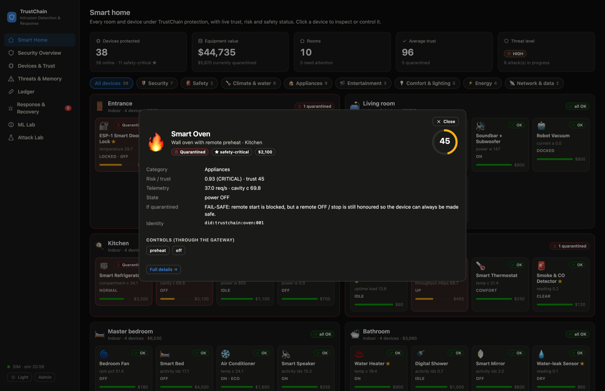

# The smart home

TrustChain-IDRS protects a fully equipped, simulated smart home: **38 devices in 10 rooms, about $44,700 of equipment**,
each with a ledger-enrolled identity, a traffic profile, a monetary value, a safety classification and a quarantine policy.
The two ESP32 boards are devices in this home too (the door lock and the security node); everything else is simulated.

The **Smart Home** page of the dashboard is the landing page: every room, every device, live trust, risk and safety status.



## Rooms and devices

★ = safety-critical (fire, flood, access, food safety, connectivity, data). *Fail mode* is what "safe" means for that device when it is
quarantined — see below.

| Room | Device | Category | Value | Fail mode |
|---|---|---|---|---|
| **Entrance** ($810) | ESP-1 Smart Door Lock ★ *(real ESP32 in hybrid mode)* | Security | $220 | fail-secure |
| | Front-door Sensor | Security | $40 | keep-running |
| | Video Doorbell | Security | $230 | keep-running |
| | Front Camera | Security | $320 | keep-running |
| **Living room** ($5,785) | Living-room Lamp | Comfort | $35 | standard |
| | OLED TV 65" | Entertainment | $2,400 | standard |
| | Soundbar + Subwoofer | Entertainment | $900 | standard |
| | Robot Vacuum | Appliances | $800 | standard |
| | Motorised Blinds | Comfort | $1,200 | standard |
| | Air Purifier | Climate | $450 | standard |
| **Kitchen** ($7,100) | Smart Refrigerator ★ | Appliances | $3,200 | keep-running |
| | Smart Oven ★ | Appliances | $2,100 | fail-safe-off |
| | Dishwasher | Appliances | $1,100 | fail-safe-off |
| | Espresso Machine | Appliances | $700 | fail-safe-off |
| **Hallway** ($880) | ESP-2 Security Node ★ *(real ESP32 in hybrid mode)* | Security | $60 | keep-running |
| | Mesh Wi-Fi Router ★ | Network | $450 | keep-running |
| | Smart Thermostat | Climate | $250 | keep-running |
| | Smoke & CO Detector ★ | Safety | $120 | keep-running |
| **Master bedroom** ($6,530) | Bedroom Fan | Climate | $180 | standard |
| | Smart Bed | Comfort | $4,500 | standard |
| | Air Conditioner | Climate | $1,600 | standard |
| | Smart Speaker | Entertainment | $250 | standard |
| **Bathroom** ($3,060) | Water Heater ★ | Climate | $900 | fail-safe-off |
| | Digital Shower | Comfort | $1,500 | fail-safe-off |
| | Smart Mirror | Comfort | $600 | standard |
| | Water-leak Sensor ★ | Safety | $60 | keep-running |
| **Home office** ($1,300) | Network Storage (NAS) ★ | Network | $1,000 | keep-running |
| | Wireless Printer | Appliances | $300 | standard |
| **Utility room** ($16,150) | Washing Machine | Appliances | $1,300 | fail-safe-off |
| | Dryer | Appliances | $1,200 | fail-safe-off |
| | Smart Energy Meter | Energy | $350 | keep-running |
| | Home Battery ★ | Energy | $9,500 | keep-running |
| | Solar Inverter | Energy | $3,800 | keep-running |
| **Garage** ($1,500) | Garage Door ★ | Security | $600 | fail-secure |
| | EV Charger | Energy | $900 | fail-safe-off |
| **Garden & pool** ($1,620) | Irrigation Controller | Climate | $200 | fail-safe-off |
| | Pool Pump | Appliances | $1,100 | fail-safe-off |
| | Backyard Camera | Security | $320 | keep-running |

The catalog lives in [`trustchain/sim/home.py`](../trustchain/sim/home.py) and is validated by tests (unique identifiers, valid rooms,
categories and profiles, every room populated, every category used).

## What "quarantined" means for a kitchen oven

A generic "block everything" policy is wrong for a home. Isolating a device must never leave it stuck in a dangerous state, and must
never switch off something that has to keep working. Each device therefore has a **fail mode**:

| Fail mode | Meaning | Examples |
|---|---|---|
| `fail-secure` | Keeps its current state. Remote *open / unlock* is blocked; a remote *close / lock* is still honoured; local keypad / mechanical access keeps working, so nobody is locked in or out. | Door lock, garage door |
| `fail-safe-off` | Remote *start* is blocked, but a remote **OFF / stop** is still honoured, so the device can always be made safe. | Oven, water heater, shower, dishwasher, washer, dryer, EV charger, pool pump, irrigation |
| `keep-running` | The service is never interrupted (cooling, connectivity, alarms, backups, measurement); only remote control commands are blocked. | Refrigerator, router, NAS, smoke detector, leak sensor, battery, energy meter |
| `standard` | Remote commands are blocked while quarantined. | TV, lamp, speaker, bed, ... |

Commands pass through the gateway in both directions. A quarantined device **cannot send** commands, and **cannot receive** them except the
hazard-reducing ones listed in [`trustchain/response.py`](../trustchain/response.py) (`ALLOW_WHEN_QUARANTINED`). Sensitive commands also
need a minimum trust in the originating device (for example `unlock`, `open` and `reboot` need 70, `preheat` needs 60).

## Controlling devices

Click any tile on the Smart Home page. The drawer shows the device's identity, value, telemetry, state, its quarantine policy and the
commands it supports; commands go through the gateway and report whether they were **allowed or blocked, and why**. Read-only sensors
show no controls.



## How the home is simulated

Devices are grouped into 16 traffic **archetypes** (`trustchain/sim/profiles.py`): the original five plus media, cycle appliances,
refrigerator, oven, climate, camera, network gear, energy, safety sensors, motorised devices and personal-care devices. Each has a
request rate, a primary sensor (for example refrigerator compartment temperature, oven cavity temperature, router throughput, EV charger
power), noise, and a **daily usage pattern** — the oven peaks around dinner, the espresso machine at 07:00, irrigation before dawn, the
EV charger overnight, the pool pump at midday. Individual devices tune their archetype (`peak`, `sharp`).

The behavioural baseline learns each device's own pattern per hour of day, so the same reading is judged against *that* device at *that*
time: 175 °C inside an oven at 18:00 is normal; 175 °C at 03:00 is an attack.

Eight attack scenarios can be launched against any device from the Attack Lab, grouped by room. Interesting cases:

| Scenario | What it models |
|---|---|
| Sensor manipulation on the refrigerator | A spoofed compartment temperature (a food-spoilage attack); caught with no static rule at all |
| Request flood on the oven | A denial-of-service against an appliance that can start a fire |
| Brute force on the door lock | Wrong-PIN guessing (also works on the real ESP-1) |
| Service probing on the router | A LAN scan |
| Replay on the garage door | A captured open-command re-sent |
| Rogue device | An unknown node joining the home network |

## Scale and false alarms

- ML inference is **batched across all devices** in a tick, so the whole 38-device home advances in about 15–20 ms per tick.
- On clean traffic across all 38 devices, the system raised a handful of **low-severity alerts and zero false quarantines**
  (numbers in [`EVALUATION.md`](EVALUATION.md)). Weak, unexplained evidence can alert the user but never escalate to blocking or
  quarantine on its own; only rule hits or strong multi-signal risk can.
- Risk and the "Suspicious" label reflect **confirmed** evidence (a rule hit, or ML flagged on consecutive ticks), so a single noisy
  reading does not paint a healthy device suspicious.

## Using it

```bash
make run                                  # full home (default)
TRUSTCHAIN_HOME=core make run             # only the five original devices (faster; what the tests use)
```

`GET /api/home` returns the catalog (rooms, categories, fail modes, every device with value and supported commands).

To add a device, append a `DeviceSpec` in `trustchain/sim/home.py` (pick an archetype from `PROFILES`), add its commands to
`COMMANDS` in `response.py`, and run the tests. Models trained on a different profile set are retrained automatically on next start.
